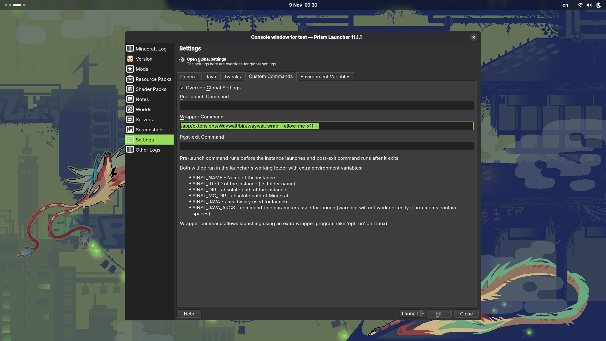

# waywall flatpak PrismLauncher extension

An extension for running [waywall](https://github.com/tesselslate/waywall) within an isolated PrismLauncher environment.

## Installation

Download [`org.prismlauncher.PrismLauncher.Extension.Waywall.flatpak`](github.com/Amchik/waywall-flatpak/releases)
from Releases and install it either through your distribution's GUI or via the terminal:
```console
$ flatpak install ./org.prismlauncher.PrismLauncher.Extension.Waywall.flatpak
```

After installation, go to the settings of a specific instance or for all of PrismLauncher: Settings -> Custom commands -> Wrapper command and enter `/app/extensions/Waywall/bin/waywall wrap --allow-mc-x11 --`.



## Configuration (Settings)

Waywall settings are stored in `~/.var/app/org.prismlauncher.PrismLauncher/config/waywall`, xkb configuration also stored in `~/.var/app/org.prismlauncher.PrismLauncher/config/xkb`.

You can copy configuration with:
```console
$ cp -r ~/.config/{xkb,waywall} ~/.var/app/org.prismlauncher.PrismLauncher/config/.
```

## libglfw

After installing `org.prismlauncher.PrismLauncher.Extension.GlfwWaylandPatch.flatpak`,
you need to enter `/app/extensions/GlfwWaylandPatch/lib/libglfw.so` in Settings -> Tweaks -> Native libraries -> GLFW library path.

## Building (Build Script)

```console
$ flatpak-builder --force-clean --repo=repo --install-deps-from=flathub builddir org.prismlauncher.PrismLauncher.Extension.Waywall.yml
$ flatpak build-bundle --runtime repo org.prismlauncher.PrismLauncher.Extension.Waywall.flatpak org.prismlauncher.PrismLauncher.Extension.Waywall stable

$ flatpak-builder --force-clean --repo=repo --install-deps-from=flathub builddir-2 org.prismlauncher.PrismLauncher.Extension.GlfwWaylandPatch.yml
$ flatpak build-bundle --runtime repo org.prismlauncher.PrismLauncher.Extension.GlfwWaylandPatch.flatpak org.prismlauncher.PrismLauncher.Extension.GlfwWaylandPatch stable
```
